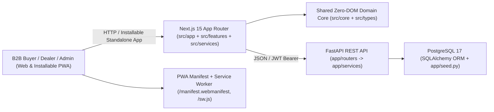
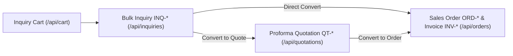

# Copian B2B & Enterprise ERP Architecture

This document explains how the Copian platform is organized end-to-end across the **Next.js 15 PWA Frontend**, **Python FastAPI Backend**, and **PostgreSQL Database**.

---

## 1. High-Level System Architecture



---

## 2. Backend Layered Architecture (`copian/backend/app/`)

The FastAPI backend strictly separates HTTP routing, domain logic, persistence, and validation:

```text
backend/app/
├── main.py                  # FastAPI app bootstrap, CORS, static /uploads, DB lifespan
├── database.py              # PostgreSQL SQLAlchemy engine & get_db() session dependency
├── auth.py                  # bcrypt password hashing, JWT creation, require_admin dependency
├── models.py                # SQLAlchemy ORM tables (Products, Inventory, Inquiries, Quotes, Orders...)
├── schemas.py               # Pydantic input validation schemas
├── seed.py                  # Idempotent startup seeding + real copian.in metadata
├── routers/                 # Thin HTTP route adapters (status codes, query/body parsing)
│   ├── auth_roles.py        # /api/auth/*, /api/roles, /api/audit-logs
│   ├── products.py          # /api/categories, /api/products, /api/compatibility, /api/upload
│   ├── inventory.py         # /api/inventory, /inward, /outward, /adjust
│   ├── sales.py             # /api/cart, /api/inquiries, /api/quotations, /api/orders, /api/contact
│   └── crm_cms.py           # /api/customers, /api/distributors, /api/cms, /api/dashboard, /api/reports
└── services/                # Pure business rules & DB transactions (reusable without HTTP)
    ├── auth_service.py      # Credential checks, demo JWT issuance, RBAC matrix persistence
    ├── catalog_service.py   # SKU slugging, multi-warehouse stock status aggregation, CSV import/export
    ├── inventory_service.py # Shared ledger transaction writer (_record_stock_transaction) & status sync
    ├── sales_service.py     # GST quotation totals, Inquiry -> Quotation -> Order workflow conversions
    └── crm_analytics_service.py # KPIs, category shares, reports, CMS upsert & global ERP search
```

---

## 3. Frontend Layered Architecture (`copian/frontend/src/`)

```text
frontend/src/
├── app/                     # Next.js 15 App Router pages + manifest.ts (URL entrypoints only)
│   ├── (storefront pages)   # /, /products, /category/[slug], /product/[sku], /compatibility, /inquiry-cart, /distributors, /about, /resources, /contact, /sitemap
│   └── admin/               # /admin, /admin/products, /inventory, /inquiries, /quotations, /orders, /customers, /distributors, /reports, /website-seo, /roles, /sitemap
├── core/                    # Framework-agnostic pure TypeScript (safe for Web + React Native/Android)
│   ├── pricing.ts           # Bulk discount slabs (0% / -8% / -15%), GST calculator, INR formatters
│   └── copianMetrics.ts     # Verified copian.in track record, OEM brands, Thane HQ contact info
├── types/
│   └── copian.ts            # Shared TypeScript interfaces matching FastAPI JSON payloads
├── services/                # Centralized typed API domain clients
│   ├── catalogApi.ts        # Categories, products, compatibility finder
│   ├── salesApi.ts          # Cart, quotations, orders, contact desk
│   └── adminApi.ts          # Executive dashboard KPIs, CMS, articles, distributors
├── features/                # Reusable domain UI widgets extracted from large route files
│   ├── catalog/             # CatalogProductCard.tsx, ProductQuickViewModal.tsx
│   └── quotations/          # ProformaPreviewCard.tsx
└── components/              # Shared global chrome & providers (StorefrontShell, AdminShell, CartContext, PwaInstallProvider, ConfirmModal, Skeleton)
```

---

## 4. Core B2B Procurement Workflow



---

## 5. PWA & Mobile Support
- Configured with [`manifest.ts`](frontend/src/app/manifest.ts), [`sw.js`](frontend/public/sw.js), `PwaInstallProvider`, and cobalt PNG app icons (`192x192`, `512x512`, `maskable`, `180x180` Apple touch icon).
- Responsive at mobile viewports (`360px+`), keeping `/api/*` traffic live network-first while enabling standalone Home Screen installation over HTTPS or `localhost`.
