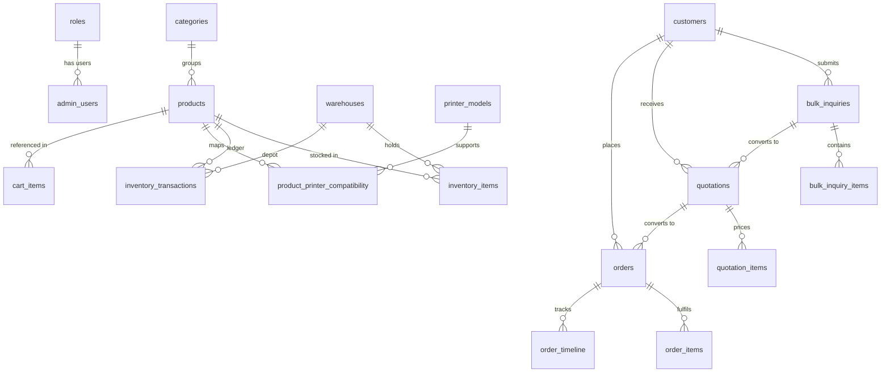

# Backend Architecture, Security & Database Schema

The Copian backend (`copian/backend/app/`) is a modular **FastAPI + SQLAlchemy 2.x + PostgreSQL 17** REST service separating HTTP transport, input validation, security/RBAC, domain services, and persistence.

---

## 1. Application Entry & Request Pipeline ([`app/main.py`](../copian/backend/app/main.py))

1. **Lifespan Bootstrap**:
   - Calls `log_security_config(logger)` to warn if default `JWT_SECRET` or `ENABLE_DEMO_AUTH=true` is active.
   - If `ENABLE_SCHEMA_AUTO_CREATE` is truthy (`1`, `true`, `yes`; defaults to `true` locally), invokes `Base.metadata.create_all(bind=engine)`.
   - Opens a `SessionLocal()` and calls `seed_database(db)` (idempotent — exits immediately if any `Role` row already exists).
2. **Global Exception Handlers**:
   - `RequestValidationError` -> HTTP `422` (`{"detail": "<field_loc>: <msg>", "errors": [...]}`)
   - `IntegrityError` -> HTTP `409` (`"Duplicate or conflicting record. Please verify unique identifiers such as SKU, email, or slug."`)
   - `SQLAlchemyError` -> HTTP `503` (`"Database operation failed safely and was rolled back. Please try again."`)
   - Unhandled `Exception` -> HTTP `500` (`"An unexpected server error occurred. Please try again."`)
3. **CORS & Static Uploads**:
   - Exposes response header `X-Total-Count` for paginated list endpoints (`/api/products`, `/api/inquiries`, `/api/orders`, `/api/customers`).
   - Mounts local uploads folder (`copian/backend/uploads/`) at `/uploads`.
4. **Routers Included**:
   - `auth_roles.router` (`/api/auth/*`, `/api/roles`, `/api/audit-logs`)
   - `products.router` (`/api/categories*`, `/api/products*`, `/api/compatibility*`, `/api/upload`)
   - `inventory.router` (`/api/inventory*`)
   - `sales.router` (`/api/cart*`, `/api/track`, `/api/buyer/*`, `/api/inquiries*`, `/api/quotations*`, `/api/orders*`, `/api/contact*`)
   - `crm_cms.router` (`/api/customers*`, `/api/distributors*`, `/api/cms`, `/api/articles*`, `/api/faqs*`, `/api/redirects*`, `/api/dashboard`, `/api/reports*`, `/api/search`)

---

## 2. Database Schema — 25 SQLAlchemy Models ([`app/models.py`](../copian/backend/app/models.py))

All `DateTime` columns use naive UTC via `utc_now()`.

### Entity-Relationship Overview

### Model Reference Table

| Domain | Model (`__tablename__`) | Key Columns & Constraints | Relationships / Cascades |
|---|---|---|---|
| **Auth & Audit** | `Role` (`roles`) | `id`, `name` (uniq), `slug` (uniq), `description`, `permissions` (`JSON`), `created_at` | `users` -> `AdminUser` |
| **Auth & Audit** | `AdminUser` (`admin_users`) | `id`, `name`, `initials` (`"AD"`), `email` (uniq), `password_hash`, `role_id` (FK `roles.id`), `is_active` (`True`), `created_at` | `role` -> `Role` |
| **Auth & Audit** | `AuditLog` (`audit_logs`) | `id`, `user_name`, `action`, `module`, `entity_id`, `details`, `created_at` | None |
| **Catalog** | `Category` (`categories`) | `id`, `name`, `slug` (uniq), `subtitle`, `description`, `image_url`, `seo_guide`, `display_order` | `products` -> `Product` |
| **Catalog** | `Product` (`products`) | `id`, `sku` (uniq), `name`, `slug` (uniq), `category_id` (FK `categories.id`), `category_name`, `brand`, `oem_code`, `short_desc`, `detailed_desc`, `page_yield` (`1500`), `yield_text`, `weight_grams`, `chip_included`, `master_carton_qty` (`20`), `moq` (`10`), `moq_unit` (`"units"`), `dealer_price` (`500.0`), `gst_rate` (`18`), `hsn_code` (`"8443"`), `compatible_printers_text`, `compatible_models` (`JSON`), `variants` (`JSON`), `features` (`JSON`), `image_url`, `gallery_images` (`JSON`), `is_featured`, `is_new_arrival`, `status` (`"Published"`), `stock_status` (`"In Stock"`), `seo_title`, `meta_description`, timestamps | `category`, `inventory_items` (`cascade="all, delete-orphan"`) |
| **Catalog** | `PrinterModel` (`printer_models`) | `id`, `brand` (idx), `model_name` (idx), `series` | None |
| **Catalog** | `ProductPrinterCompatibility` (`product_printer_compatibility`) | `id`, `product_id` (FK `products.id` `ON DELETE CASCADE`), `printer_model_id` (FK `printer_models.id` `ON DELETE CASCADE`) | Junction link table |
| **Inventory** | `Warehouse` (`warehouses`) | `id`, `name` (uniq), `code` (uniq), `city`, `state` (`nullable=False`) | None |
| **Inventory** | `InventoryItem` (`inventory_items`) | `id`, `product_id` (FK `CASCADE`), `warehouse_id` (FK `CASCADE`), `available_qty` (`0`), `reserved_qty` (`0`), `reorder_level` (`50`), `suggested_reorder_qty` (`200`), `updated_at` | `product`, `warehouse` |
| **Inventory** | `InventoryTransaction` (`inventory_transactions`) | `id`, `txn_code` (uniq), `product_id`, `warehouse_id`, `txn_type` (`Inward`/`Outward`/`Adjustment`), `prev_qty`, `delta_qty`, `new_qty`, `reference_code`, `reason`, `performed_by`, `created_at` | `product`, `warehouse` |
| **CRM** | `Customer` (`customers`) | `id`, `company_name`, `contact_name`, `phone`, `email`, `gstin`, `city`, `state`, `pincode`, `classification` (`"Corporate Buyer"`), `credit_limit` (`250000.0`), `notes`, `created_at` | Linked by ID in inquiries/quotes/orders |
| **CRM** | `Distributor` (`distributors`) | `id`, `name`, `city`, `state`, `territory` (`"West India"`), `address`, `phone`, `email`, `gstin`, `status` (`"Active"`), `associated_dealers` (`15`), `ytd_orders_value` (`0.0`), `created_at` | None |
| **Sales** | `CartItem` (`cart_items`) | `id`, `session_id` (idx), `product_id` (FK `SET NULL`), `sku`, `product_name`, `description_line`, `image_url`, `moq`, `moq_unit`, `quantity`, `note`, `created_at` | None |
| **Sales** | `BulkInquiry` (`bulk_inquiries`) | `id`, `inquiry_code` (uniq), `customer_id`, `company_name`, `contact_name`, `phone`, `email`, `gstin`, `delivery_city`, `notes`, `status` (`"New"`), `assigned_salesperson`, `internal_note`, `source` (`"Website Cart"`), timestamps | `items` (`cascade="all, delete-orphan"`) |
| **Sales** | `BulkInquiryItem` (`bulk_inquiry_items`) | `id`, `inquiry_id` (FK `CASCADE`), `product_id`, `sku`, `product_name`, `quantity`, `unit_note` | `inquiry` |
| **Sales** | `Quotation` (`quotations`) | `id`, `quote_code` (uniq), `inquiry_id`, `customer_id`, `customer_name`, `customer_email`, `customer_phone`, `customer_gstin`, `valid_until`, `gst_rate` (`18`), `gst_label`, `subtotal`, `discount_amount`, `shipping_amount`, `gst_amount`, `grand_total`, `status` (`"Draft"`), `notes`, timestamps | `items` (`cascade="all, delete-orphan"`) |
| **Sales** | `QuotationItem` (`quotation_items`) | `id`, `quotation_id` (FK `CASCADE`), `product_id`, `sku`, `product_name`, `quantity`, `unit_price`, `line_total` | `quotation` |
| **Sales** | `Order` (`orders`) | `id`, `order_code` (uniq), `invoice_code` (uniq), `quotation_id`, `inquiry_id`, `customer_id`, `customer_name`, `shipping_address`, `gstin`, `subtotal`, `gst_amount`, `total_amount`, `payment_status` (`"Pending"`), `fulfilment_status` (`"Ready to Dispatch"`), `courier_name`, `tracking_number`, timestamps | `items`, `timeline` (`order_by="OrderTimeline.id"`, `cascade`) |
| **Sales** | `OrderItem` (`order_items`) | `id`, `order_id` (FK `CASCADE`), `product_id`, `sku`, `product_name`, `quantity`, `unit_price`, `line_total` | `order` |
| **Sales** | `OrderTimeline` (`order_timeline`) | `id`, `order_id` (FK `CASCADE`), `event_title`, `is_highlighted` (`False`), `created_at` | `order` |
| **CMS/SEO** | `CmsSetting` (`cms_settings`) | `id`, `key` (uniq: `seo`, `homepage`, `contact`, `metrics`, `testimonials`, `volume_slabs`, `about`), `value` (`JSON`), `updated_at` | None |
| **CMS/SEO** | `Article` (`articles`) | `id`, `slug` (uniq), `category`, `title`, `summary`, `content`, `image_url`, `is_featured`, `is_published`, `created_at` | None |
| **CMS/SEO** | `Faq` (`faqs`) | `id`, `question`, `answer`, `display_order`, `is_published` | None |
| **CMS/SEO** | `SeoRedirect` (`seo_redirects`) | `id`, `source_path`, `target_path`, `status_code` (`301`), `is_active` | None |
| **Support** | `ContactMessage` (`contact_messages`) | `id`, `full_name`, `company_name`, `email`, `phone`, `inquiry_type`, `message`, `status` (`"New"`), `created_at` | None |

---

## 3. Authentication, RBAC & Rate Limiting ([`auth.py`](../copian/backend/app/auth.py), [`security.py`](../copian/backend/app/security.py))

### 3.1 Admin JWT & RBAC Matrix
- Passwords hashed and checked using `bcrypt` (`hash_password`, `verify_password`).
- JWT tokens signed with `HS256` using `JWT_SECRET` and **24-hour expiration** (`ACCESS_TOKEN_EXPIRE_HOURS = 24`):
  - Admin payload: `{ "sub": "<user_id>", "email": "...", "role": "<role_slug>", "exp": ... }`
- FastAPI dependencies:
  - `require_admin`: requires active `AdminUser` matching Bearer token (`401` otherwise).
  - `require_permission(module, action)`:
    - Immediately grants access if `user.role.slug == "super-admin"`.
    - Otherwise checks `user.role.permissions[module][action] == True`; raises HTTP `403` (`"Insufficient permission (<module>:<action>)"`) if missing.
    - Supported action keys: `view`, `create`, `edit`, `delete`, `approve`, `export`.
    - Seeded module keys in `seed.py`: `Products & Categories`, `Inventory & Stock Ledger`, `Bulk Inquiries & Quotations`, `Orders & GST Invoices`, `Customers & Distributors`, `Website & SEO`, `Reports & Analytics`. (`Roles & Permissions` is restricted to `super-admin` unless explicitly added.)

### 3.2 Buyer Self-Service JWT Auth (`require_buyer`)
- Buyers do **not** use passwords or generated SMS/email OTP codes.
- `POST /api/buyer/login` matches `Customer` case-insensitively by `email`, then verifies `verification` against either:
  1. Exact case-insensitive `Customer.gstin`, OR
  2. Trailing **4 or more digits** of `Customer.phone`.
- Issues a Buyer JWT containing `{ "sub": "<customer_id>", "email": "...", "token_type": "buyer", "exp": ... }`.
- `require_buyer` rejects non-buyer tokens (`payload.get("token_type") != "buyer"`) and scopes `/api/buyer/portal` and `/api/buyer/orders/{order_id}/pdf` exclusively to records owned by `customer.id`.

### 3.3 Rate Limiting (`rate_limit(bucket, max_calls, window_seconds)`)
Client IP extracted from first `X-Forwarded-For` address or `request.client.host`. Uses Redis fixed-window (`copian:rl:{bucket}:{ip}:{window}`) when `REDIS_URL` is reachable, otherwise an in-memory thread-safe sliding window (`deque` + `threading.Lock`). Returns HTTP `429` on burst:

| Route | Bucket | Limit |
|---|---|---|
| `POST /api/auth/login` | `auth_login` | 15 / 60s |
| `POST /api/buyer/login` | `buyer_login` | 15 / 60s |
| `POST /api/contact` | `contact_submit` | 15 / 60s |
| `POST /api/inquiries` | `create_inquiry` | 20 / 60s |
| `POST /api/track` | `track_lookup` | 30 / 60s |

---

## 4. Service Layer Architecture (`copian/backend/app/services/`)

### 4.1 `catalog_service.py`
- **Stock Status Aggregation (`serialize_product`)**: Sums `available_qty` & `reserved_qty` across all `InventoryItem` rows per product (`min_reorder` defaults to `50`):
  - `total_avail <= 0` -> `"Out of Stock"`
  - `total_avail <= min_reorder` -> `"Low Stock"`
  - `moq >= 25` & `stock_status == "MOQ 25"` -> `"MOQ 25"`
  - Else `"In Stock"`
- **Compatibility Matching (`find_compatible_products`)**: First queries `ProductPrinterCompatibility` joined to `PrinterModel` (`ILIKE` on model name and optional brand). Falls back to `Product.compatible_printers_text ILIKE` text matching if the junction returns no hits or `model` is omitted.
- **Bulk Actions & CSV**: Supports `publish`, `draft`, and `delete` via `POST /api/products/bulk`. CSV import (`csv.DictReader`) inserts new SKUs (skipping existing SKUs) and seeds opening stock in the first warehouse.
- **Image Uploads (`storage_service.py`)**: Enforces `<= 10 MB` and extensions `{.png, .jpg, .jpeg, .webp, .gif, .svg}`. Saves to `copian/backend/uploads/` (`UPLOAD_BACKEND="local"`) or S3/R2 (`boto3` when `UPLOAD_BACKEND` is `"s3"` or `"r2"`).

### 4.2 `inventory_service.py`
- **`inward` / `outward` / `adjust`**: Every stock mutation routes through `_record_stock_transaction(...)` to atomically adjust `InventoryItem.available_qty`, append an immutable `InventoryTransaction` (`TXN-9042+`), log an `AuditLog`, and synchronize `Product.stock_status`.
- **Order Reservation & Fulfilment Hooks**:
  - Creating/converting an Order calls `reserve_stock_for_order` -> increments `reserved_qty` on the warehouse item with highest `available_qty`.
  - Transitioning `fulfilment_status` to `"Dispatched"` triggers `commit_dispatch_for_order` (idempotent per `order_code`), decrementing both `reserved_qty` and `available_qty` and recording an `"Outward"` ledger transaction as `"System ERP"`.
  - Transitioning to `"Cancelled"` calls `release_reserved_stock_for_order`, decrementing `reserved_qty`.

### 4.3 `sales_service.py`, `pdf_service.py` & `notification_service.py`
- **Code Sequence Conventions**:
  - Cart Clear: Submitting `POST /api/inquiries` with `session_id` deletes matching `CartItem` rows and auto-creates a `Customer` if `email` isn't already registered.
  - Inquiries: `INQ-4813 + count` | Quotations: `QT-2026-0{843 + count}` | Orders/Invoices: `ORD-{1093 + count}` / `INV-2026-{442 + count}`.
- **Pricing & GST**:
  - `compute_quote_totals`: `taxable = max(0.0, subtotal - discount + shipping)`, `gst = round(taxable * gst_rate / 100, 2)`. Note that backend quotations take explicit `discount_amount` (frontend calculates bulk volume slab suggestions). Direct orders apply `18%` GST on `subtotal`.
  - **ReportLab A4 PDFs (`pdf_service.py`)**: Checks buyer GSTIN prefix `"27"` (Maharashtra) or billing address keywords (`maharashtra`, `mumbai`, `thane`, `pune`, `nagpur`, `nashik`, `navi mumbai`) to render **`CGST` + `SGST`** (`gst_rate/2` each) vs **`IGST`** (`gst_rate%`).
  - **Async Emails (`notification_service.py`)**: Dispatched via FastAPI `BackgroundTasks` on inquiry creation/update and quotation send (attaching generated quotation PDF).
- **Public Reference Lookup (`lookup_order_or_inquiry`)**: Looks up Order (`ORD-*` or `INV-*`), Quotation (`QT-*`), or Inquiry (`INQ-*`), validating buyer ownership via `_contact_matches` (exact case-insensitive email or `>= 4` trailing phone digits).

### 4.4 `crm_analytics_service.py`
- **Credit & Overdue Ledger**: For each customer, considers unpaid orders (`payment_status in ("Credit 30d", "Pending")`) to compute `credit_used`, `credit_available = max(0, credit_limit - credit_used)`, and `overdue_30d_amount` (unpaid orders older than 30 days).
- **CMS Merging**: `get_cms_data` merges `cms_settings` DB rows (`seo`, `homepage`, `contact`, `metrics`, `testimonials`, `volume_slabs`, `about`) over hardcoded defaults (`DEFAULT_CONTACT`, `DEFAULT_METRICS`, `DEFAULT_TESTIMONIALS`, `DEFAULT_VOLUME_SLABS`, `DEFAULT_ABOUT`) so public storefront pages remain functional immediately.
- **Dashboard & Reports**: Aggregates real PostgreSQL order monthly/quarterly revenue (`trends`), category inventory share percentages (`category_shares`), top SKUs by revenue, warehouse valuation, customer spend activity, and inquiry-to-order conversion funnel.

---

## 5. Implementation Quirks & Maintainer Notes

Keep these directly observed behaviors in mind when modifying backend code:

1. **Warehouse State Column vs Schema**: `Warehouse.state` in `models.py` is `nullable=False` with no default, while `WarehouseCreate` (`schemas.py`) accepts `name`, `code`, `city` (and `POST /api/inventory/warehouses` relies on SQLite/existing handling or would fail Postgres `NOT NULL` if `state` isn't supplied/defaulted — check `Warehouse.state` if extending warehouse creation in production Postgres).
2. **Router Permission Key Mappings**:
   - `DELETE /api/inventory/warehouses/{id}` checks `require_permission("Inventory & Stock Ledger", "edit")` (not `"delete"`).
   - `DELETE /api/customers/{id}` and `DELETE /api/distributors/{id}` check `require_permission("Customers & Distributors", "approve")` (not `"delete"`).
   - Several `AuditLog` entries (`PUT /api/roles/{role_id}`, `CREATE/UPDATE/DELETE_PRODUCT`, `SEND_QUOTATION`, `PUBLISH_CMS`) currently record static `user_name="Arjun Mehta"` rather than pulling `current_user.name`.
3. **Code Numbering Uses Table `count()`**: Sequence IDs (`TXN-`, `INQ-`, `QT-`, `ORD-`, `INV-`) compute next numbers via `db.query(...).count()`. Deleting records can cause ID collisions if existing records are removed rather than archived.
