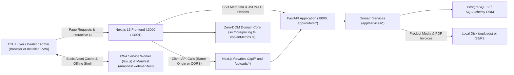

# Copian B2B & Enterprise ERP — Developer Documentation

Comprehensive technical documentation for the **Copian B2B E-Commerce Storefront & Enterprise ERP Platform** built for Copian International (Thane, Maharashtra — OEM-compatible printer consumables, bulk toner powders, OPC drums, inkjet inks, and printer spare parts).

---

## Documentation Index

| Document | Audience & Scope | Key Contents |
|---|---|---|
| **[Getting Started & Operations](./GETTING_STARTED.md)** | New developers, QA, DevOps | Prerequisites, Windows `start-dev.ps1`, manual backend/frontend runbooks, Docker Compose, `.env` variables, Alembic migrations, seeded demo logins, ngrok tunneling, and CI test commands |
| **[Backend Architecture, Auth & Database](./BACKEND_ARCHITECTURE_AND_DB.md)** | Backend & full-stack engineers | FastAPI lifespan & exception handlers, all 25 SQLAlchemy ORM models + ER diagram, Alembic (`0001`–`0003`), idempotent seed data, JWT & RBAC security, rate limiting, ReportLab PDF & SMTP background jobs, S3/R2/local uploads, and service layer rules |
| **[REST API Reference](./API_REFERENCE.md)** | Frontend, mobile, QA, integrators | All **81** FastAPI endpoints + static `/uploads` mount: exact paths, auth/RBAC gates, query/path params, Pydantic request schemas, response shapes, headers (`X-Total-Count`), and status codes |
| **[Storefront Pages & Features](./STOREFRONT_PAGES_AND_FEATURES.md)** | Product & storefront engineers | Every public route (`/` through `/sitemap` + SEO routes), Hero auto-slider showcase, Catalogue faceted filtering, Printer Compatibility Finder, BOM CSV cart upload, Public Tracker, and Buyer Portal |
| **[Admin ERP Workspace Guide](./ADMIN_ERP_GUIDE.md)** | ERP & full-stack engineers | `/admin/login` + all **12** Admin ERP modules, `AdminAuthContext` & `AdminShell`, RBAC matrix & deep-link guards, CSV import/export, A4 Proforma/GST Invoice PDFs, CMS/SEO publisher, and ERP sitemap |
| **[Frontend Architecture, Skeletons & PWA](./FRONTEND_ARCHITECTURE_AND_PWA.md)** | Frontend & UI engineers | App Router architecture, Next.js API/upload rewrites, shared zero-DOM `src/core/`, `CartContext`/`CmsContext`/`PwaInstallProvider`, Tailwind M3 design tokens, motion & smooth scroll, 1-to-1 skeleton loading system, and `sw.js` PWA caching |

---

## Tech Stack at a Glance

| Layer | Technology | Entrypoint / Config |
|---|---|---|
| **Frontend Framework** | Next.js `^15.1.6` (App Router, Turbopack in dev), React `^19.0.0`, TypeScript `^5.7.2` | [`copian/frontend/package.json`](../copian/frontend/package.json) |
| **Styling & Design System** | Tailwind CSS `^3.4.17` (`@tailwindcss/forms`), custom M3 Cobalt palette (`#00366B`), `globals.css` motion & `.skeleton-shimmer` | [`tailwind.config.ts`](../copian/frontend/tailwind.config.ts), [`copian_b2b_design_system.md`](../copian_b2b_design_system.md) |
| **Backend API** | Python 3.13, FastAPI `>=0.115.0`, Pydantic `>=2.10.0`, Uvicorn | [`copian/backend/requirements.txt`](../copian/backend/requirements.txt), [`app/main.py`](../copian/backend/app/main.py) |
| **Database & Migrations** | PostgreSQL 17, SQLAlchemy `>=2.0.36` (`psycopg` v3), Alembic `>=1.14.0` | [`app/database.py`](../copian/backend/app/database.py), [`alembic.ini`](../copian/backend/alembic.ini) |
| **Auth & Security** | `bcrypt` password hashing, `PyJWT` (`HS256`, 24h tokens), sliding-window / Redis rate limiter | [`app/auth.py`](../copian/backend/app/auth.py), [`app/security.py`](../copian/backend/app/security.py) |
| **Documents & Media** | ReportLab `>=4.2.0` A4 Proforma/Tax Invoice PDFs, optional `smtplib` async emails, Local or S3/R2 uploads | [`pdf_service.py`](../copian/backend/app/services/pdf_service.py), [`storage_service.py`](../copian/backend/app/services/storage_service.py) |
| **Containerization & CI** | Multi-service `docker-compose.yml`, GitHub Actions workflow (`unittest`, `tsc`, `next build`) | [`docker-compose.yml`](../copian/docker-compose.yml), [`.github/workflows/ci.yml`](../.github/workflows/ci.yml) |

---

## Repository Directory Layout

```text
stitch_copian_b2b_redesign/
├── .github/workflows/ci.yml          # GitHub Actions CI (backend unittest + frontend tsc/build)
├── copian_b2b_design_system.md       # Design tokens, typography & semantic color spec
├── docs/                             # Developer documentation suite (this folder)
└── copian/                           # Main full-stack monorepo application
    ├── README.md                     # Quick-start overview
    ├── ARCHITECTURE.md               # Concise architectural summary
    ├── docker-compose.yml            # PostgreSQL 17 + FastAPI + Next.js production stack
    ├── start-dev.ps1                 # Windows script launching backend (:8000) & frontend (:3000)
    ├── backend/
    │   ├── alembic/                  # Migrations 0001_baseline .. 0003_customer_credit_limit
    │   ├── app/
    │   │   ├── main.py               # FastAPI bootstrap, lifespan, CORS, global error handlers
    │   │   ├── database.py           # Engine, SessionLocal, get_db()
    │   │   ├── models.py             # 25 SQLAlchemy ORM models
    │   │   ├── schemas.py            # 35 Pydantic request/response schemas + GSTIN validator
    │   │   ├── auth.py               # bcrypt, Admin & Buyer JWTs, RBAC require_permission()
    │   │   ├── security.py           # In-memory / Redis rate limiting + startup warnings
    │   │   ├── seed.py               # Idempotent startup seeding (roles, SKUs, printers, CRM)
    │   │   ├── routers/              # 5 HTTP router modules (auth_roles, products, inventory, sales, crm_cms)
    │   │   └── services/             # 8 domain service modules (no FastAPI coupling in core logic)
    │   ├── tests/                    # unittest suite (9 API integration + 5 service unit tests)
    │   └── uploads/                  # Local uploaded product media served at /uploads/*
    └── frontend/
        ├── next.config.ts            # /api/* & /uploads/* backend proxy rewrites, dev origins
        ├── public/                   # sw.js, /icons/* (PWA), /images/* (brand & product photography)
        └── src/
            ├── app/                  # Next.js 15 App Router pages, loading.tsx skeletons, SEO routes
            ├── components/           # Shells, Context providers, Skeleton.tsx, PWA install modal
            ├── core/                 # Platform-agnostic pricing/GST & brand constants
            ├── features/             # Catalog cards, hero showcase, product detail, proforma card
            ├── lib/api.ts            # Fetch wrapper, ngrok/same-origin resolution, admin/blob auth
            ├── services/             # Typed API modules (catalogApi, salesApi, adminApi)
            └── types/copian.ts       # Shared TypeScript interfaces matching FastAPI payloads
```

---

## High-Level System Architecture



---

## Core End-to-End B2B Order Lifecycle

```mermaid
flowchart LR
  Store["Storefront Discovery (/products, /compatibility, /product/[sku])"]
  Cart["Inquiry Cart (/inquiry-cart -> /api/cart)"]
  Inq["Bulk Inquiry INQ-* (/api/inquiries)"]
  Quote["Proforma Quotation QT-2026-* (/api/quotations)"]
  Ord["Confirmed Order ORD-* & Invoice INV-2026-* (/api/orders)"]
  Disp["Dispatch & Stock Deduction (InventoryTransaction TXN-*)"]
  Portal["Buyer Self-Service (/track-order & /account Buyer Portal)"]

  Store -->|"Add at MOQ / Bulk Qty or Upload BOM CSV"| Cart
  Cart -->|"Submit RFQ (clears session cart)"| Inq
  Inq -->|"Convert to Quotation (Draft)"| Quote
  Inq -->|"Direct Convert (reserves stock)"| Ord
  Quote -->|"Convert to Order (reserves stock)"| Ord
  Ord -->|"Mark Dispatched + courier/AWB"| Disp
  Disp --> Portal
```



---

## Architectural Conventions Every Contributor Should Know

1. **Strict Layer Separation**:
   - Backend HTTP routers (`app/routers/*.py`) only parse HTTP inputs, apply `require_permission(...)` / `rate_limit(...)` dependencies, set headers (`X-Total-Count`), and delegate to `app/services/*.py`.
   - Frontend UI routes (`src/app/**`) consume typed clients in `src/services/*` or `apiFetch`, while pure domain math (`VOLUME_SLABS`, `computeGstBreakdown`, `isValidOptionalGstin`, INR formatters) stays inside zero-DOM `src/core/pricing.ts` for code sharing.
2. **Same-Origin Dev & Tunnel Proxying**:
   - Browser code runs through `getApiBase()` in [`src/lib/api.ts`](../copian/frontend/src/lib/api.ts): when the hostname is non-local (e.g., an `*.ngrok-free.dev` URL) and `NEXT_PUBLIC_API_URL` points to `localhost`/`127.0.0.1`, it automatically uses `""` (same-origin) so [`next.config.ts`](../copian/frontend/next.config.ts) proxies `/api/*` and `/uploads/*` to FastAPI without browser mixed-content/CORS issues.
3. **1-to-1 Skeleton Loading & Reduced Motion**:
   - Every major Storefront and Admin ERP route pairs an App Router `loading.tsx` file with in-page `loading` skeleton components from [`Skeleton.tsx`](../copian/frontend/src/components/Skeleton.tsx) using `.skeleton-shimmer` (`globals.css`), automatically simplified when `prefers-reduced-motion: reduce` is enabled.
4. **Permissions at Both UI and API Boundaries**:
   - Backend routes enforce module/action permissions via `require_permission(module, action)` using PostgreSQL `roles.permissions` JSONB/JSON matrices, while `AdminShell` (`AdminAuthContext.tsx`) enforces module view access pre-paint (`useIsomorphicLayoutEffect`) to eliminate unauthorized UI flicker.
